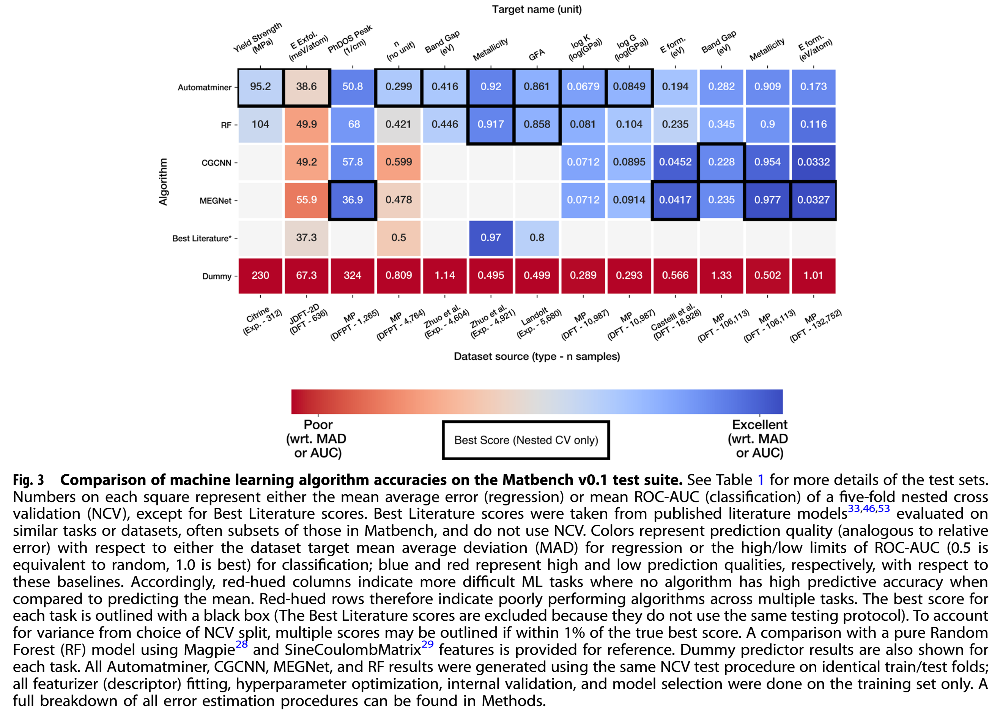

# PaperScope：可追溯论文图表阅读与证据复现

从一篇真实材料论文出发，用AI与本地工具交付**完整图表、图注、上下文及可复算出处**。本教程围绕一个明确的小问题：如何把Matbench论文Figure 3变成其他读者能够核查、重新生成的局部证据，而不把定位网格误当成原图，也不截掉决定解读范围的图注？



这是一次实际完成的无历史AI执行R37，使用与Skill赛项Attempt62601相同的13文件工具版本。GitHub本篇只讨论该图表任务，不复用其他研究咨询任务的效率结论；两个赛项的范围不同。旧GitHub投稿61911为工作台文章，78分属于旧稿，本篇是新增原始PDF入口、定位/裁图工具及实际复现案例，不把旧分数当新版成绩。

## 1. 阅读难点：裁到图，不等于保留解读条件

来源：Dunn, Wang, Ganose, Dopp & Jain, *Benchmarking materials property prediction methods: the Matbench test set and Automatminer reference algorithm*, npj Computational Materials (2020), DOI [10.1038/s41524-020-00406-3](https://doi.org/10.1038/s41524-020-00406-3)。使用2026-10-30保存的出版方PDF，原件在materials/paper.pdf，SHA256为003a1bf09c4f7e2959a5cabef0910ec7d91e739836c13cdcf575c4d121539830。文件内Figure3位于物理第4页。

图中不同任务、算法行、任务列、单位、色标与标记共同构成阅读对象。只保留彩色矩阵、丢掉列名/单位或下方图注，读者就不能确认比较对象与图示范围。图注不是装饰。不同PDF版本可能改变单位标签；本篇不转录模型分数、不比较算法优劣，不提供整篇论文结论核查，故不把裁图成功等同数字/科学内容认证。研究决策中的勘误核查属于Skill赛项另一个完整任务范围。

传统截图只有像素，无法说明原页、坐标和源版本；放大图片也无法恢复源文件缺失的细节。这里把**导航图、未标注上下文、正式证据图**分开，并用真实出处记录关联原件。

## 2. 方法与实现取舍

1. 模型先读Skill，再在自身输入中定位原PDF，实测哈希；没有预供页图或裁剪坐标。
2. 用overview生成整页上下文以及独立带比例尺/网格的locator。网格用于估计原页的归一化坐标，不能混入正式证据。
3. 模型查看定位预览，自行选择矩形，生成正式裁图；查看正式图与未标注上下文，确认图注末句、标签与图例均在范围内。
4. 保存源哈希、物理页、坐标、比例、渲染器版本、脚本哈希和图像哈希。
5. 在全新目录从同一PDF实际重渲染，比较PNG哈希；保存原记录，不用新时间戳替代历史出处。

坐标采用原页左上为(0,0)、右下为(1,1)，**不含locator额外边框**。本次矩形为[0.065,0.072,0.95,0.55]，5倍渲染；原页画布595.2760009765625×790.8660278320312，对应画布矩形[38.69294006347656,56.942354003906246,565.5122009277344,434.9763153076172]。工具先渲染整页，再向外取整到像素边界裁切，不缩放拼接内容。overview及context为1.5倍，定位层单独保存。

这些参数使“看到了完整图注”成为可检查的交付，而不是让程序自动判定科学正确。numeric_content_verified始终为false。工具不做OCR；旋转页需另行处理，不能直接套用坐标。

## 3. 实际执行与结果

完整原始任务见cases/task.txt；事前验收和预算见cases/protocol.json。工具没有接入模型API，实际模型执行发生在Codex desktop独立无历史子代理，遥测显示gpt-6.1-sol、medium。允许本地PowerShell、Python、文件读取和图片查看；不联网，不读取其他运行答案。预算900秒、15次可见调用、指令性10000输出token，单次本地调用120秒停止；没有服务端硬限。

交付包含整页预览、locator、正式Figure3、未标注context、出处JSON和说明。正式图2635×1891像素，保留算法行、任务列、单位、色标/标记、完整图注，末尾Methods句未裁掉。原始AI说明见runs/R37/说明.md。作者侧再次目视核对，并从原件重渲染overview和figure3，四份PNG均逐字节一致。另有49项作者工程检查完成，但不把它们作为49个真实模型案例。

|完整一次执行遥测|值|
|---|---:|
|墙钟时间|229.933秒|
|可见调用（包括错误）|9|
|累计输出token|2033|
|累计输入token|280103|
|其中缓存输入|253824|

没有无Skill对照，以上是描述，不构成提速或省token证据。累计输入跨多次调用重复包含上下文，不是唯一原文长度；服务现金费用不可取得，不能从token推算人民币。作者开发/打包/复核额外开销没有测量为零。

首次执行误以为PDF位于输入根目录，Get-FileHash报不存在，随后渲染因缺少哈希参数退出；模型在自身输入查找到project/materials/paper.pdf后成功。失败、查找和重试完整保留于logs/text-export.jsonl，不将流程写成零错误。正式裁图没有后续重裁，未被作者修改。父级调度不透明编码已省略，源哈希保留；不重建无法取得的任务派发密文。

## 4. 从干净目录重做

本目录可单独下载，所有必需输入都在包内。建议Python3.12.14，并安装实际验证版本：

```sh
python -m pip install pypdfium2==5.14.0 Pillow==12.3.0
python -B -X utf8 reproduce.py --out ../paperscope-figure-replay
```

输出目录必须不存在。reproduce.py验证源PDF和脚本哈希，运行原始renderer生成overview及figure3，比较两组region/context共4PNG与locator图哈希，再次核验9份原始产物未变。生成的provenance时间会不同，检查的是输入、脚本、渲染参数与图像字节，不能用新时间戳伪装原始执行。

也可以手动运行：

```sh
python -B -X utf8 skill/scripts/render_region.py --pdf materials/paper.pdf --page 4 --overview --expected-sha256 003a1bf09c4f7e2959a5cabef0910ec7d91e739836c13cdcf575c4d121539830 --out ../overview-new
python -B -X utf8 skill/scripts/render_region.py --pdf materials/paper.pdf --page 4 --rect-normalized 0.065 0.072 0.95 0.55 --scale 5 --expected-sha256 003a1bf09c4f7e2959a5cabef0910ec7d91e739836c13cdcf575c4d121539830 --out ../figure-new
```

先打开overview/locator.png，坐标只参考原页面区域；再看figure3/region.png及context.png，逐项核对算法/任务标签、单位、图例及图注末句。原PDF始终是判断基准。若换论文或PDF版本，重新查看并选择坐标，不能直接照抄本例矩形。

重做模型实践时，将cases/task.txt作为完整任务，提供materials/paper.pdf和skill目录，使用清空历史的新会话；根据自己的平台修正输入/输出目录和Python路径。历史提示中的绝对路径只是当时运行配置，不是复现必须使用的用户名。模型版本不可锁定、输出和坐标可能不同。无需新模型调用也可以按上述脚本离线核验已有交付；机械重放不是重新做AI实验。

## 5. 实践带来的具体认识

- **导航与证据分离**：额外网格解决坐标定位，未标注图用于原文核查；不能把辅助标记当论文内容。两类文件由不同出处记录关联。
- **坐标需绑定版本和页画布**：归一化参数降低手工换算负担，仍依赖相同源PDF、页旋转与渲染策略；哈希用于拒绝错版本，不能认证出版来源。
- **图注边界要视觉检查**：本例完整保留了图注末句。程序生成图像不保证内容完整，需要回看整页和正式裁图；这不等于自动数值核验。
- **可复现性应实测**：真正从原PDF重渲染并比图像哈希，比仅验证文件存在更强；仍不能推出科学结论正确或新论文普遍成功。

一次已知论文上的窄任务、同模型开发AI和作者侧目视检查，无法代替人工专家、未知论文测试或大样本效果验证。本篇不声称相对其他流程更快、更准确，也未在玻尔科学空间网页执行此案例。仓库保留另外的玻尔CLI真实实践，但不将它冒充本案例生态工具调用。

## 6. 材料索引、来源与个人贡献

- skill/：完整13文件，与Skill投稿62601对应工具版本一致；本例仅按需使用render_region.py，其他入口供完整工作流使用，不要求裁图任务跑四视图。
- materials/paper.pdf、source.json、page4.txt：原PDF、来源许可/原始哈希及真实物理第4页提取文本；文本不能替代图表图像。
- cases/：真实完整输入与事前验收协议；runs/R37/：9份实际输出、图像和出处。
- logs/：完整可见事件的文字导出与方法说明；只将内嵌图片data URL换成注明源哈希的省略标记，全部文字/调用/失败保留；原图片均在runs中。无隐藏推理或虚构工具事件。
- checks/：原始产物快照、原生遥测及本次干净重渲染结果。reproduce.py是作者侧核验入口，不是模型生成的历史输出。

论文及图表按CC BY4.0署名分享，第三方素材以原PDF单独信用说明为准；裁图是原图的明确派生，locator添加的导航标记单独标注。作者原创Skill、渲染工具、流程设计、实验组织、核验脚本与教程按MIT，AI实际参与及执行范围如上；没有把论文或AI原始文字冒称为人工独立成果。
