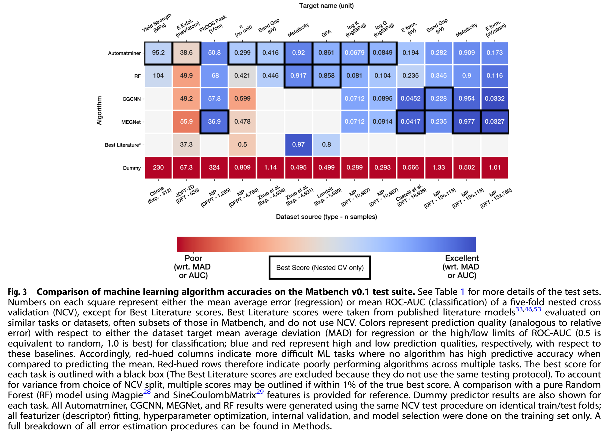

# PaperScope：把论文证据、研究建议和材料缺口连起来

PaperScope是面向材料研究者的论文阅读Skill：把用户的问题转成原文核查项，组织图表、数值、适用条件和下一步建议，并交付能够回到PDF检查的材料。本篇用同一版本的三类真实执行，展示它如何在材料完整和材料不完整时提供不同而具体的帮助。

## 先看成果与实际作用

|使用情境|实际交付|对读者的作用|
|---|---|---|
|需要一张可核查的论文图|R37完整Figure3、图注、定位预览、未标注上下文与出处|保留单位、图例和解释条件，便于带回组会/阅读讨论|
|只有摘要，却需要精确图表数字|R48/R50均区分已知事实、待核验数字与具体补充资料；各通过6项开发验收|把笼统“材料不足”变成可执行的下一步|
|需要判断论文如何指导自己的研究|R49给出数据审计、成分/工艺/测试条件、基线和分组验证方案；新AI复核23/24、交付6/6|把方法介绍转成有条件的研究行动清单|
|需要复核和移交结果|从实际PDF、工作记录重建四视图和图像；干净目录执行结果随包|让别人按公开步骤检查读数、计算和交付，而不是依赖演示截图|

这里的6项和23/24是开发验收与新会话AI复核，不是GitHub官方评分；它们的来源和范围逐项给出。本篇不将Skill赛项分数或其他任务的资源变化当成GitHub案例效果。

## 1. 一个研究问题，三种输入状态

案例论文：Dunn, Wang, Ganose, Dopp & Jain, *Benchmarking materials property prediction methods: the Matbench test set and Automatminer reference algorithm*, npj Computational Materials (2020) 6:138，DOI [10.1038/s41524-020-00406-3](https://doi.org/10.1038/s41524-020-00406-3)。原PDF与作者勘误10.1038/s41524-020-00433-0均随包提供。Matbench是任务测试套件，Automatminer是参考自动建模流程；理解这两个角色，才能判断论文中的结果如何用于自己的任务。

研究者可能需要“把图完整交给我”，也可能要问“某两种方法误差差多少，对我的约350条钢数据有什么意义”。前者重点在图表和图注的完整交付，后者必须确认指标、单位、版本与评估条件。输入只有摘要时，应把可证实的摘要信息和仍需原图的数字分开。

约350条钢数据是用于检验阅读方法的明确合成情境，实际完成的是论文阅读和研究方案建议。三个情境使用相同13文件Skill，完整版本在公开目录skill/。离线包包含执行本篇核验所需的Skill入口、数值参考与原渲染器，以及正常报告的原重建程序、工作记录和实际图像；其余未使用的装配/导入代码在公开目录保留。

## 2. 图表交付：把“看到了图”变成“能检查依据”

R37的实际任务为从原PDF物理第4页交付Figure3及完整图注。模型先读Skill，查看独立带网格的整页定位预览，自行选择原页归一化区域[0.065,0.072,0.95,0.55]，5倍渲染；正式图与context不叠加导航标记。输出2635×1891像素，保留算法行、任务列、单位、色标、标记与图注末尾Methods句。



图源Dunn等（2020），CC BY4.0；这是原页裁剪派生，不是重画的数据图。

技术取舍在于让导航与证据分离：locator方便估计坐标，正式图方便读数，上下文方便核对页内语境。provenance登记PDF哈希、页码、坐标、比例、脚本和渲染器版本。用户拿到的不是孤立截图，而是一组能定位原件的阅读材料。

已有真实失败也保留：首次猜错PDF目录导致文件不存在、随后缺哈希参数退出；在自身输入定位正确路径后完成。失败日志没有被“成功摘要”替代。

## 3. 摘要输入：用证据缺口指导下一次阅读

新增C初测R48与独立复测R50，均只得到原PDF物理第1页的忠实摘要节选及来源登记，却被要求核对Figure3的钢任务误差、单位、差值和相对差。它是明确构造的部分材料条件，不冒称真实用户偶发故障；事前冻结材料、六项标准及预算，再分别在无历史会话中运行。

两次实际输出见boundary/R48-answer.md、R50-answer.md。它们均做了以下工作：

- **划清输入范围**：指出本次摘要没有Figure3，而不是断言完整论文未报告。
- **分开解释与计算**：误差值、指标和单位保留待核验；给出条件公式(RF−Automatminer)/RF×100%，不伪造操作数。
- **保留有用依据**：摘要的13任务、8项最好与样本量概括，仍可以说明研究背景；不把汇总结果当钢任务胜率。
- **列出可执行补充请求**：对应版本原图/PDF、完整图注、标签单位及相关方法；对本地应用再核实成分、工艺、测试与分组条件。

它给读者的帮助是“现在能判断什么，以及下一步找什么”，使阅读在材料不完整时仍有明确进展。两次六项验收均获父级和另一个无历史AI复核通过，处理行为一致；验收项目与实际原文分别保存。这里只证明本构造条件的重复行为，不外推所有异常。

保留的细节包括R48补充请求预设了图表行列方向，原图实际是任务列/算法行；它没有据此补数字。新AI也建议更明确索取对应勘误。这些观察与原答案一起留档，未替执行者修写。

## 4. 完整材料：从论文比较走到研究行动

R49以完整主PDF、勘误和原研究任务做正常复测。答案入口normal/results/answer.md；四份核心输出分别服务快速阅读、逐条主张核查、条件比较及数值审计。

|阅读对象|实际处理|形成的研究作用|
|---|---|---|
|论文312条钢样本与合成350条情境|核查composition输入、屈服定义、工艺、测试温度与有效独立组数|确定哪些条件需要先整理，再投入模型比较|
|Automatminer与组成RF|给出Dummy/Ridge/RF起点、参数搜索范围、相同分组折与预算记录|使论文方法成为可执行的比较方案|
|95.2与104的图表读数|核对MAE、MPa与已更正的本地PDF；结合勘误确认单位标签|把数值、版本和解释条件连接起来|
|两模型误差差异|用Decimal复算8.8 MPa、以104为分母降低8.46%，注明舍入和方向|让读者按原始值检查派生计算|
|新牌号/成分外推|按牌号、炉批、近重复组成设计组隔离、内外层调参及锁定留出|让验证目的与后续候选应用相对应|

这里8.46%是按论文显示值计算的MAE差异，不是PaperScope性能提升或统计显著性。方案和未知条件均有标注，实际未清洗/训练350条数据。新会话AI复核R49为23/24、交付6/6；关注角色解释更直接的表达，以及根目录结果引用需按完整包上下文阅读等细节。

离线重建从真实PDF和作者工作记录重新提取引句、定位、计算及装配，不读取已保存的四视图来冒充生成。原始工作记录、原始重建代码、必要图像和来源一起提供。复核脚本把共享文件映射到新的临时目录，保持原程序不变，再生成和比对四份核心结果及三组图像。

## 5. 按公开步骤重做

实际验证环境：Python3.12.14、pypdf6.10.0、pypdfium2 5.14.0、Pillow12.3.0。

```sh
python -m pip install pypdf==6.10.0 pypdfium2==5.14.0 Pillow==12.3.0
python -B -X utf8 reproduce-all.py --out ../paperscope-replay
```

输出目录必须不存在。脚本执行三种可检查动作：从原PDF重渲染R37、验证两个C输入与实际输出/原始选段的文件对应、用原R49程序在全新目录重建研究报告。result.json分别记录结果。已有运行在新目录成功：R37四张证据图片及定位图一致，R49四核心结果及图像一致；代码和原始输出未被核验者修复。

若要重新进行模型使用实践，按cases/task.txt和boundary/task.txt分别提供完整材料或仅摘要，使用清空历史的会话及公开完整skill/，根据本机更改历史输入/输出绝对路径。离线脚本复核已有交付，重新运行模型则是另一次实践，两者记录应分开。

### 独立检查每项实际结论

1. 查看runs/R37/figure3与overview，放大核对图注、单位及末句；再看原PDF物理p4。
2. 只读boundary/materials，再读两个C回答，检查数字是否来自当前材料，补充请求是否具体。
3. 读normal/results/comparison.csv，把论文条件与本地需求逐行对照；检查建议是否标为建议。
4. 对照normal/results/numeric-review.json、原图及勘误，核对8.8 MPa/8.46%的分母、方向与单位。
5. 运行reproduce-all.py，再查看输出中的检查记录，不把文件存在当成实际重建。

## 6. 真实记录与技术洞察

|运行|实际工具/模型|墙钟秒|可见调用|累计输出token|
|---|---|---:|---:|---:|
|R37图表任务|Codex desktop，gpt-6.1-sol/medium|229.933|9|2033|
|R48部分材料|同上，独立无历史|188.396|4|1805|
|R50异常复测|同上，独立无历史|180.510|4|1846|
|R49完整任务复测|同上，独立无历史|485.614|16|10536|

这些是实际完整执行口径，不是受控提速比较；没有现金账单，不把token换算费用。原生输入/缓存信息在checks的遥测记录中。作者准备、调度、核验和打包另外有投入。

实践表明，Skill的作用可以通过几种具体交付来检验：图表能否完整回到原件；数字能否对应单位和版本；材料不足时能否给出具体资料请求；研究建议能否成为行动清单；结果能否按说明重新生成。C初测/复测与正常任务组合，使这些作用有实际输入、输出和核验记录支撑。

## 7. 来源、贡献与材料索引

论文与勘误原件、图表按各自CC BY4.0署名，第三方内容遵守原信用说明。作者原创Skill、渲染/重建流程、实验组织、核验程序与教程按MIT；AI实际参与执行与审阅已说明，不冒充人工专家验证。当前案例没有在玻尔科学空间网页执行，仓库其他真实玻尔CLI实践不移用于本例加分。

公开目录保存完整13文件Skill、全部本次分享材料及完整可见文字日志；投稿离线包是该固定版本中与本篇三种动作相关的文件子集。它包含实际使用的Skill入口、数值参考与原渲染器，原件/读数/图像、完整任务、C两次原始答案、正常报告、原始工作记录与重建程序，以及必要执行选段和复核摘录。

日志选段逐行保留原事件：只省略环境权限样板、不透明派发元信息及与已附任务/Skill/原文重复的成功读取回显；工具调用、实际失败/自修正、写入结果和最终回复均保留。source-spans.json记录来源哈希、行号/偏移与省略原因，完整导出在公开supplement/供核查。图片编码以显式源哈希标记替换，实际图像随包提供。没有新增或伪造工具事件。

checks/review-excerpts.md是原新会话AI复核中C与R49部分的原样连续摘录，来源范围及哈希有记录；原完整评审在公开supplement/。它是同模型家族开发审阅，不等于官方评审。更早正常结果只作为原复核背景，不在本篇单独宣称其完整复现。

检查范围和细节见package-scope.json、源映射及真实记录。当前已知论文单例支持这些声明，数字真实性仍须阅读原图，工程重放不自动证明科学结论。
